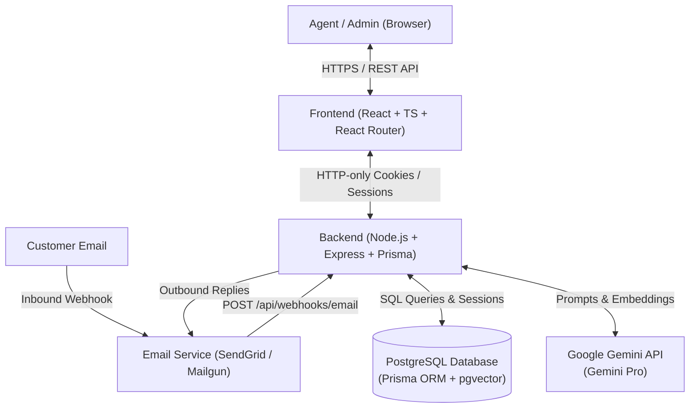

# Tech Stack Specification

This document defines the selected technology stack and architectural choices for the **AI-Powered Ticket Management System**, based on the requirements in `project-scope.md`.

---

## 1. Architecture Overview

A decoupled client-server architecture consisting of a **React SPA frontend**, a **Node.js/Express REST API backend**, **PostgreSQL** managed with **Prisma ORM**, and containerized deployment with **Docker**.

---

## 2. Frontend

- **Core Library**: React (with TypeScript)
- **Routing**: React Router (v6/v7) for client-side routing, protected routes, and layouts
- **Build Tool**: Vite (fast builds, optimized bundling)
- **Styling**: Tailwind CSS
- **UI Primitives**: Headless UI / Radix UI / Lucide React icons
- **State & Data Fetching**: TanStack Query (React Query) for server state caching and polling, and Axios/Fetch with credentials enabled (`withCredentials: true`)

### Key Pages & Views
- `/login`: Session authentication page
- `/dashboard`: High-level metrics, ticket volume, category distributions
- `/tickets`: Filterable & sortable list of tickets (by status, category, agent)
- `/tickets/:id`: Detailed conversation view, AI summaries, AI suggested replies, status controls
- `/admin/users`: Admin-only agent creation and management
- `/admin/knowledge-base`: Knowledge base document management for AI retrieval

---

## 3. Backend & API

- **Runtime**: Node.js (TypeScript)
- **Framework**: Express.js
- **ORM**: Prisma ORM
- **Database**: PostgreSQL (with `pgvector` extension for knowledge base embeddings)
- **Validation**: Zod (for request payload and webhook validation)
- **Session & Security Middleware**:
  - `helmet` (HTTP headers security)
  - `cors` (configured with strict origin and `credentials: true`)
  - `express-rate-limit` (API rate limiting)

---

## 4. Authentication & Authorization

- **Mechanism**: **Database Sessions**
- **Session Manager**: `express-session` with a persistent database store (e.g., `connect-pg-simple` or Prisma session store via `@quixo3/prisma-session-store`)
- **Cookie Security**:
  - `httpOnly: true` (prevents XSS access)
  - `secure: true` in production (HTTPS only)
  - `sameSite: 'lax'` or `'strict'` (CSRF protection)
- **Role-Based Access Control (RBAC)**:
  - **Admin**: Full access, including agent provisioning, knowledge base updates, and system settings.
  - **Agent**: Access to view tickets, update statuses, edit/send replies, and view AI recommendations.

---

## 5. AI & Knowledge Base

- **AI Provider**: **Google Gemini** (via `@google/genai` or `@google/generative-ai` SDK)
  - **Gemini Pro**: High-reasoning model for complex ticket classification, category tagging, deep thread summaries, and human-friendly RAG-augmented response generation.
  - **Gemini Flash** *(optional for lightweight tasks)*: Fast, low-latency triage and initial sentiment checks.
- **Embeddings**: Google `text-embedding-004` (for vectorizing knowledge base articles and semantic retrieval).
- **RAG & Knowledge Base**:
  - Knowledge base articles chunked and stored with vector embeddings in PostgreSQL (`pgvector`).
  - Contextual retrieval matches incoming ticket content to relevant support documentation prior to generating draft responses.

---

## 6. Email Integration

- **Provider**: **SendGrid** or **Mailgun**
- **Inbound Processing**:
  - Inbound Parse Webhook configured to forward incoming emails to `POST /api/webhooks/email`.
  - Parses subject, sender, body (plain text & HTML), and attachments into new ticket records.
- **Outbound Delivery**:
  - Transactional email API for sending agent-approved or auto-generated responses.
  - Preserves email threading headers (`In-Reply-To`, `References`, and ticket reference ID in subject).

---

## 7. Deployment & Infrastructure

- **Containerization**: **Docker**
  - Multi-stage Dockerfile for the frontend (Vite build served via Nginx).
  - Multi-stage Dockerfile for the backend (TypeScript compilation, Prisma generation, lightweight Node runtime).
- **Orchestration**: `docker-compose.yml` for local development and production deployment containing:
  - `client`: React application container
  - `server`: Express API container
  - `db`: PostgreSQL container (with `pgvector` pre-installed)
- **Environment Management**: `.env` configurations managed per environment (API keys, database URLs, session secrets).
